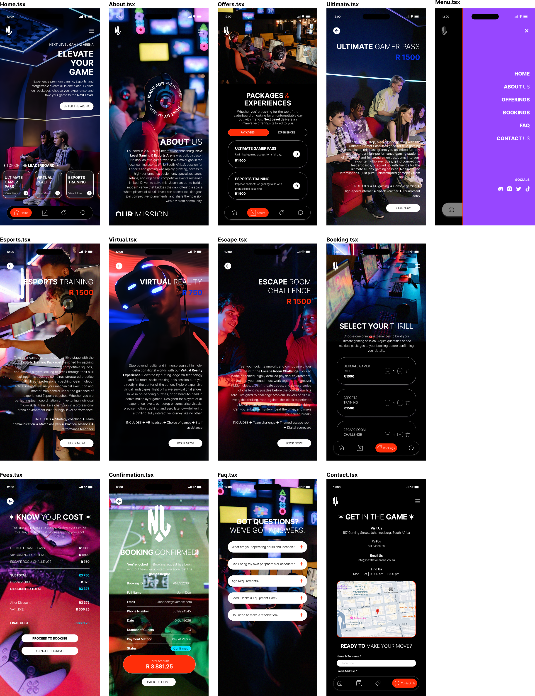
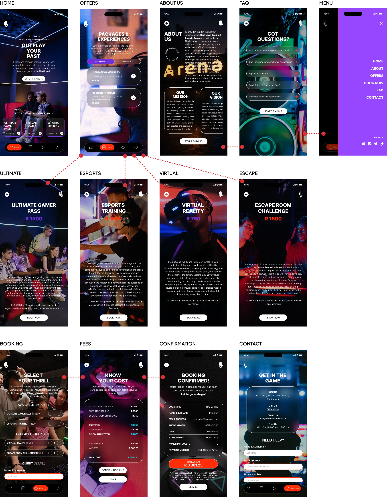

# NEXT LEVEL GAMING ARENA APP | DESIGN CHANGELOG
## From Task 2 Initial Wireframes to Final App UI Design & Development

### SUMMARY OF MAJOR DESIGN CHANGES

- **Home**: Visual and content refinement.
- **Offers**: Layout and card redesign.
- **Booking**: Major layout and workflow improvement.
- **Contact**: Major visual redesign.
- **Ultimate Gamer Pass**: Content and layout refinement.
- **Esports Training**: Content and layout refinement.
- **Virtual Reality**: Content and layout refinement.
- **Escape Room**: Content and layout refinement.
- **Fees**: Cost breakdown refinement.
- **Confirmation**: Information hierarchy improvement.
- **About Us**: Content restructuring and redesign.
- **FAQ**: Layout and visual refinement.
- **Menu**: Navigation refinement.

### 1. OVERALL DESIGN DEVELOPMENT

The initial Task 2 wireframes (`APP WIREFRAMES TASK 2`) established the app's core concept, branding and functionality. 

The final UI (`APP WIREFRAMES FINAL`) builds on this foundation by refining layouts, improving consistency and simplifying the booking process to create a more polished, cohesive and user-friendly gaming experience.

### 2. GLOBAL DESIGN AND VISUAL CHANGES

- **Consistent Visual Identity**: Established a more consistent visual identity across the application.
- **Contrast & Imagery**: Improved contrast between text and background imagery.
- **Spacing & Alignment**: Refined spacing, alignment and positioning of interface elements.
- **Standardised Elements**: Standardised the appearance of buttons, cards and navigation elements.
- **Accent Colours**: Used accent colours more strategically to highlight prices, selections and important actions.
- **Visual Hierarchy**: Improved the overall visual hierarchy, making important information easier to identify.
- **Color Palette**: Developed a more consistent use of black, blue, purple and orange/red accents.

### 3. SCREEN-BY-SCREEN CHANGELOG

#### 3.1 HOME SCREEN

##### Changes:
- Changed the main headline from `Elevate Your Game` to `Outplay Your Past`.
- Updated the introductory text to make the app's purpose clearer.
- Improved the positioning and hierarchy of the main heading and call-to-action.
- Refined the presentation and spacing of featured gaming package cards.
- Standardised the bottom navigation and active `Home` indicator.

##### Reason:
- To create a stronger first impression and make available gaming experiences easier to discover.

#### 3.2 OFFERS / PACKAGES SCREEN

##### Changes:
- Refined the `Packages` and `Experiences` tab layout.
- Introduced a more prominent purple accent for the selected `Packages` tab.
- Updated package cards with a lighter, translucent appearance.
- Improved the readability of package descriptions and pricing.
- Standardised the circular arrow buttons used to access individual offers.
- Improved spacing between package cards.

##### Reason:
- To improve the presentation of available services and make it easier for users to browse and compare offerings.

#### 3.3 BOOKING SCREEN

##### Changes:
- Reworked the booking selection process into a more consolidated screen.
- Introduced separate sections for `Available Packages` and `Available Experiences`.
- Added visible quantity controls for each selectable service.
- Displayed prices alongside each service.
- Introduced a dedicated `Client Details` section.
- Added fields for the client's `Name` and `Surname`.
- Repositioned booking controls to create a more logical sequence.

##### Reason:
- To reduce the number of steps required to make a booking and allow users to select services and enter their details within one screen.

#### 3.4 CONTACT SCREEN

##### Changes:
- Reorganised the contact page into a more structured interface.
- Introduced a blue gaming-themed background.
- Grouped business information into a dedicated contact card.
- Organised the `Address`, `Telephone Number`, `Email Address` and `Operating Hours` into separate sections.
- Added a more prominent contact form.
- Improved the arrangement of the contact form fields.
- Retained the map to help users identify the business location.

##### Reason:
- To make contact information easier to find and create a more professional contact experience.

#### 3.5 ULTIMATE GAMER PASS SCREEN

##### Changes:
- Retained the full-screen promotional layout.
- Improved the positioning of the service heading and `R1 500` price.
- Refined text layout and spacing.
- Maintained the gaming image as the main visual element.
- Kept the booking call-to-action clearly visible.

##### Reason:
- To maintain consistency between individual service pages while improving readability and presentation.

#### 3.6 ESPORTS TRAINING SCREEN

##### Changes:
- Maintained the esports training photography.
- Improved the placement of the heading and `R1 500` price.
- Refined descriptive content and spacing.
- Improved the presentation of included features.
- Standardised the `Book Now` button.

##### Reason:
- To make the service information easier to read and maintain consistency across all offering pages.

#### 3.7 VIRTUAL REALITY SCREEN

##### Changes:
- Retained the VR-themed imagery.
- Improved the alignment of the heading and `R750` price.
- Refined the descriptive text layout.
- Improved the visibility of included features.
- Standardised the booking call-to-action.

##### Reason:
- To create a consistent presentation of the different gaming experiences.

#### 3.8 ESCAPE ROOM CHALLENGE SCREEN

##### Changes:
- Maintained the escape room imagery.
- Improved the heading and price positioning.
- Refined descriptive text and included features.
- Standardised the `Book Now` button.

##### Reason:
- To ensure that all individual service pages follow the same design structure.

#### 3.9 FEES / COST BREAKDOWN SCREEN

##### Changes:
- Improved the presentation of selected services and their prices.
- Introduced a more structured itemised cost breakdown.
- Clearly separated `Subtotal`, `Discount`, `Discounted Total`, `VAT` and `Final Cost`.
- Improved the visibility of the final amount.
- Retained the `Proceed to Booking` and `Cancel Booking` actions.
- Refined the distinction between cost information and action buttons.

##### Reason:
- To improve pricing transparency and help users understand what they will pay before confirming their booking.

#### 3.10 BOOKING CONFIRMATION SCREEN

##### Changes:
- Refined the booking confirmation layout.
- Organised booking information into clearly defined sections.
- Improved the presentation of `Booking ID`, `Customer Details`, `Booking Date`, `Number of Guests` and `Payment Method`.
- Made the total amount more prominent.
- Improved the visibility of booking status.
- Retained the option to return to the home screen.

##### Reason:
- To provide users with a clearer booking summary and reassurance that their booking has been successfully recorded.

#### 3.11 ABOUT US SCREEN

##### Changes:
- Refined the `About Us` content layout.
- Improved the presentation of the company's background and introduction.
- Introduced more structured content sections.
- Added dedicated `Our Mission` and `Our Vision` cards.
- Improved the positioning of logo and brand elements.
- Introduced a clearer call-to-action at the bottom of the page.

##### Reason:
- To make the company's identity, purpose and long-term vision easier to understand.

#### 3.12 FAQ SCREEN

##### Changes:
- Improved the presentation of frequently asked questions.
- Maintained the expandable question-and-answer layout.
- Refined the appearance of question cards.
- Improved the positioning of expand icons.
- Updated the background imagery to complement the gaming theme.
- Added a `Start Gaming` call-to-action.

##### Reason:
- To make it easier for users to find answers to common questions without having to contact the business directly.

#### 3.13 MENU / NAVIGATION SCREEN

##### Changes:
- Retained the distinctive purple navigation panel.
- Improved the alignment and spacing of menu items.
- Standardised navigation labels.
- Maintained access to `Home`, `About`, `Offers`, `Book Now`, `FAQ` and `Contact`.
- Retained social media icons.
- Improved the overall presentation of the menu.

##### Reason:
- To provide a clearer navigation structure and allow users to move between the main sections of the application.

### 4. NAVIGATION AND USER JOURNEY IMPROVEMENTS

The final design presents a more structured user journey:

1. **`Home`**: Users discover the gaming arena and available services.
2. **`Offers`**: Users explore packages and gaming experiences.
3. **`Booking`**: Users select services, quantities and enter client details.
4. **`Fees`**: Users review the subtotal, discount, VAT and final amount.
5. **`Confirmation`**: Users receive a summary of their booking and payment details.

#### Key improvements:
- Service discovery is clearer.
- Package browsing is more organised.
- Booking selection and client details are brought together.
- Pricing is presented more transparently.
- Confirmation information is easier to review.
- Navigation is more consistent across screens.

### 5. USABILITY AND USER EXPERIENCE IMPROVEMENTS

- **Visual Hierarchy**: Improved visual hierarchy: headings, prices and calls-to-action are easier to identify.
- **Component Consistency**: Consistent interface components: buttons, cards and navigation elements follow a more unified design approach.
- **Streamlined Workflow**: Simplified booking process: service selection and client information are brought together to reduce unnecessary navigation.
- **Pricing Clarity**: Better pricing transparency: users can review costs before proceeding.
- **Readability**: Improved readability: text positioning, spacing and contrast are refined.
- **Navigation Accessibility**: Clearer navigation: the bottom navigation and menu provide consistent access to the app's main sections.
- **Brand Reinforcement**: Stronger brand identity: gaming imagery and neon-inspired colours reinforce the **Next Level Gaming Arena** identity.

### 6. FEATURES RETAINED FROM TASK 2

The following elements were retained because they already supported the app's purpose and design direction:

- Dark gaming-inspired aesthetic.
- **Next Level Gaming Arena** branding and logo.
- Main gaming packages and experiences.
- Individual service information pages.
- Service pricing.
- Booking cost breakdown.
- Booking confirmation information.
- Frequently asked questions.
- Contact information and location map.
- Bottom navigation and side menu.

These elements formed the foundation of the final design, with refinements made where necessary.

### 7. FINAL OUTCOME

The final UI builds upon the original Task 2 design, retaining its core concept and functionality while improving usability, consistency and visual appeal. Key improvements include a more streamlined booking process, clearer pricing and confirmation screens, and a more organised layout. Overall, the final **Next Level Gaming Arena** application delivers a cohesive, user-friendly experience that effectively reflects the brand identity and meets customer needs.

### FINAL DESIGN ACHIEVEMENT

A more consistent gaming application with improved service discovery, a clearer booking journey, better pricing communication and a stronger overall visual identity.